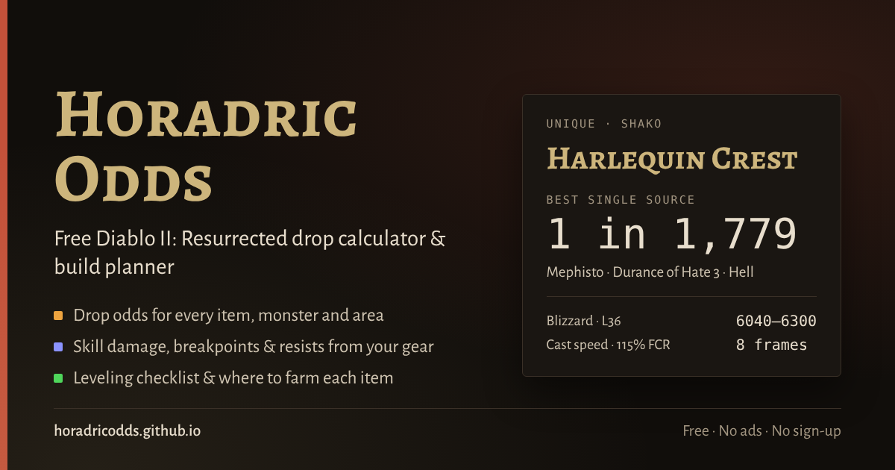

# Horadric Odds

**A free Diablo II: Resurrected drop calculator and build planner.**
No ads, no sign-up, works on PC and phone.

👉 **Open it: [horadricodds.github.io](https://horadricodds.github.io/)**

## What it does

### Drop odds
- Search any unique, set item, rune, runeword or base. Player nicknames like "shako" work.
- Hover over (or tap) any item name on the site to see its full stats, worded as the game shows them.
- See every monster and area that drops it, and your chance per kill for your difficulty, player count and magic find.
- Search by the stats you want, look up any monster's loot, or work out gambling odds.
- Includes terror zones, Find Item and first-kill quest drops.

### Build planner
- Skill trees for all eight classes, including Warlock. Hover over a skill (or press and hold on a phone) for its in-game tooltip: damage at your level and the next, synergies, masteries and, for attack skills, your damage with the weapon you've planned.
- Breakpoints worked out from your gear: cast speed, hit recovery, block and attack frames.
- An equipment panel that shows your gear at any level, with each item's stats on hover or tap.
- Resistances per difficulty, Str/Dex requirement checks, and a gear plan that shows where to farm each item.
- A level-by-level leveling guide with a checklist to tick off while you play.
- Side-by-side build comparison.
- Starter builds to open in the planner, with links to the matching Maxroll and Icy Veins guides.
- Share builds as links or build codes.
- **Import save:** load a single-player character (.d2s) to open its build with its skills, stats and gear (magic and rare items by name), fill your Grail and count your runes; add your shared stash (.d2i) too. Files are read on your device and never uploaded.

### Experience
- Enter your level and see how much experience, how many kills and how many full clears it takes to reach your next level or a goal level.
- Areas are ranked by experience per full clear or per kill for your difficulty, players, party and experience bonuses. Tap one to see what to kill there.
- Terror zone experience, boss kill experience and a suggested route to your goal level.

### Tools
- **Holy Grail tracker:** tick off every unique, set item and rune you find, with progress by type and a link to where each missing item drops.
- **Rune helper:** enter your runes to see which runewords you can make now, which you could make after cubing runes up (with the exact steps and gems), and which you're one rune short of. Search by name, nickname (cta, coh, hoto…) or rune.
- **Run tracker:** count and time your boss runs, log drops, and compare your luck with the calculator's odds.
- **Save editor:** load an offline character (.d2s from D2R, Lord of Destruction 1.14d or Classic 1.14d) to change its level, stats, skills and gold, move, copy or delete items, and add any unique, set item, runeword, rune or gem, or a magic or rare item with the affixes you pick, then download the edited save.
- **Cube recipes:** every Horadric Cube recipe from the game files, searchable by ingredient.
- **Roll checker:** type in your item's numbers to see how good each roll is, from 0% to perfect.
- **Sockets & affixes:** how many sockets a base can get at its item level (Larzuk and cube), and which magic or rare affixes can roll on it, including charms.

### Offline and as an app
- Once opened, the site works without an internet connection, and you can install it to your phone's home screen or as a desktop app from your browser.

### How to use
- The **How to use** tab walks through each tool step by step and answers common questions.
- Link straight to a tab by adding it to the address: [#how-to-use](https://horadricodds.github.io/#how-to-use), [#planner](https://horadricodds.github.io/#planner), [#experience](https://horadricodds.github.io/#experience), [#grail](https://horadricodds.github.io/#grail), [#runes](https://horadricodds.github.io/#runes), [#runs](https://horadricodds.github.io/#runs), [#cube](https://horadricodds.github.io/#cube), [#rolls](https://horadricodds.github.io/#rolls), [#affixes](https://horadricodds.github.io/#affixes) or [#import](https://horadricodds.github.io/#import). Drop odds links carry the item and settings you picked.

## Reporting problems

- **Bugs and ideas:** [open an issue](https://github.com/HoradricOdds/horadricodds.github.io/issues).
- **Anything else, including takedown requests:** HoradricOdds@hotmail.com

When reporting wrong odds or numbers, it helps to include the item or build, the settings you used (difficulty, players, magic find, level), and what you expected. The version at the bottom of the page tells us which copy you were using.

## Credits

- **Game data:** items, drop tables, skill trees and skill formulas come from the game files via [blizzhackers/d2data](https://github.com/blizzhackers/d2data) (MIT License, © 2020 blizzhackers).
- **Attack frames:** animation frame data and timing rules follow [Warren1001's IAS Calculator](https://github.com/Warren1001/IAS_Calculator) (animation tables dumped by RuffnecKk).
- **Breakpoints:** cast, hit-recovery and block tables from [d2runewizard](https://d2runewizard.com/breakpoints), with the Warlock tables checked against [AOEAH](https://www.aoeah.com/news/4399--d2r-warlock-fcr-ias-fhr-fbr-breakpoints--calculation).
- **Experience:** rules checked against [The Amazon Basin wiki](https://theamazonbasin.com/wiki/index.php/Experience). Monster counts per area come from [u/Pavke](https://www.reddit.com/user/Pavke/)'s Experience Calculator, which was also used to check the numbers. Thanks, Pavke!
- **Builds:** the starter builds are written for Horadric Odds from the game data and common community knowledge. For full guides, see [Maxroll](https://maxroll.gg/d2/category/guides) and [Icy Veins](https://www.icy-veins.com/d2/); each build links to them.
- **Prices:** the optional price links open [diablo2.io](https://diablo2.io/)'s price check for the item, with permission from its admin. Horadric Odds doesn't collect or store any price data.

Horadric Odds is free and fan-made. It isn't affiliated with or endorsed by Blizzard Entertainment, Maxroll, IGN, Icy Veins or diablo2.io. Diablo II: Resurrected and its game data belong to Blizzard Entertainment.

## How it's built

The whole site is a single `index.html` file with no server, plus `manifest.webmanifest`, `sw.js` and the icons for offline use and installing. Odds are calculated in your browser from the game's own tables. Saved builds, settings, your Grail, runes and run trackers stay in your browser.
